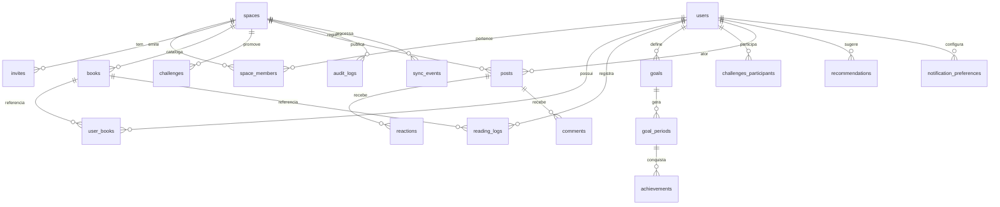

# Data Model — Minha Leitura

**Fase 1** — entidades persistidas no PocketBase (servidor) e espelhadas no IndexedDB
(Dexie) no cliente. Convenções gerais:

- PK do PocketBase: `id` (string 15). Datas de calendário: `YYYY-MM-DD`. Timestamps: ISO
  UTC (`created`, `updated`). Fuso de negócio: `CF_TIMEZONE` (default `America/Sao_Paulo`).
- Todas as entidades de domínio (exceto `users`) têm `space` (FK obrigatória) e são
  isoladas por regra de acesso derivada da sessão. Entidades pessoais têm também `owner`
  (FK `users`) para separar acervo/metas entre os membros do espaço.
- Entidades sincronizáveis têm `sync_id` (UUID), `updated_by` (FK `users`), `deleted_at`
  (soft delete) e `created`/`updated`.
- O cliente mantém cópia local em Dexie com o mesmo formato + metadados de sincronização
  (`_dirty`, `_pendingOutboxId`). Períodos de meta (`goal_periods`) são **derivados** e
  podem ser recalculados localmente a partir de `goals` + `reading_logs`.

## ERD (visão geral)

## Collections

### users (auth collection)

| Campo | Tipo | Regras |
|-------|------|--------|
| `email` | email (auth) | único, obrigatório |
| `name` | text | obrigatório, 1–80 |
| `avatar` | file (imagem) | opcional, ≤ 2 MB |
| `active` | bool | default `true` |
| `twofa_enabled` / `twofa_setup_completed` | bool | default `false` |
| `twofa_secret_encrypted` | text | AES-GCM; nunca exposto |
| `recovery_codes_hashed` | json | hashes; nunca exposto |
| `webauthn_credentials` | json | credenciais de App Lock (client) |
| `last_known_device` | text | rótulo do último device |
| `last_login_at` | date | UTC |
| `created` / `updated` | datetime | automáticos |

**Segurança**: campos `twofa_secret_encrypted` e `recovery_codes_hashed` ocultos para
qualquer leitura via API (apenas hooks acessam).

### spaces

| Campo | Tipo | Regras |
|-------|------|--------|
| `name` | text | obrigatório, 1–80 |
| `settings` | json | preferências gerais (ex.: template de card, notificações) |
| `created_by` | relation(users) | obrigatório |
| `sync_id` | text | UUID |
| `updated_by` | relation(users) | — |
| `deleted_at` | datetime | soft delete |
| `created` / `updated` | datetime | — |

### space_members

| Campo | Tipo | Regras |
|-------|------|--------|
| `space` | relation(spaces) | obrigatório |
| `user` | relation(users) | obrigatório |
| `role` | select | `owner \| partner \| viewer` |
| `invite_status` | select | `pending \| accepted` |
| `joined_at` | date | — |
| `sync_id` / `updated_by` / `deleted_at` | — | padrão |

**Índice único**: `(space, user)`. **Limite**: uso pessoal/casal; recomenda-se ≤ 2 papéis
plenos (`owner`, `partner`) por espaço, validado no aceite do convite.

**Matriz de permissões (FR-004, FR-024)**:

| Capacidade | owner | partner | viewer |
|-----------|:----:|:------:|:-----:|
| Ler acervo/progresso/feed do espaço | ✅ | ✅ | ✅ |
| Criar/editar/excluir os próprios livros/logs/metas | ✅ | ✅ | ❌ |
| Ver metas/progresso dos outros membros | ✅ | ✅ | ✅ |
| Curtir/comentar no feed | ✅ | ✅ | ❌ |
| Criar/editar desafios conjuntos | ✅ | ✅ | ❌ |
| Convidar membros | ✅ | ✅ | ❌ |
| Remover membros / alterar papéis | ✅ | ❌ | ❌ |
| Configurações de segurança | ✅ | ❌ | ❌ |
| Exportar / apagar histórico | ✅ | ✅ | ❌ |

### invites

| Campo | Tipo | Regras |
|-------|------|--------|
| `space` | relation(spaces) | obrigatório |
| `role` | select | `partner \| viewer` |
| `email_invited` | email | obrigatório |
| `token_hash` | text | hash do token CSPRNG; nunca exposto |
| `expires_at` | datetime | `now + 15–30 min` |
| `used_at` | datetime | null até uso |
| `used_by` | relation(users) | null |
| `single_use` | bool | default `true` |

### books

Metadados de obra, compartilhados dentro do espaço (evita duplicar quando os dois leem o
mesmo livro). Pode vir do catálogo externo ou ser manual.

| Campo | Tipo | Regras |
|-------|------|--------|
| `space` | relation(spaces) | obrigatório |
| `title` | text | obrigatório, 1–300 |
| `authors` | json | lista de strings |
| `isbn` | text | opcional, normalizado |
| `cover_url` | url | opcional; imagem de capa (catálogo) |
| `cover_local` | text | opcional; chave/URL local do blob em cache no IndexedDB (client-only, não sincroniza) |
| `total_pages` | number | opcional (obrigatório para meta de páginas do livro) |
| `genres` | json | gêneros/tags |
| `source` | select | `manual \| open_library \| google_books` |
| `external_id` | text | id na fonte externa (dedup) |
| `created_by` | relation(users) | — |
| `sync_id` / `updated_by` / `deleted_at` | — | padrão |

**Índice**: único por `(space, source, external_id)` quando `external_id` presente.

**Apresentação (FR-032..FR-034)**: a estante renderiza um grid responsivo com a capa de cada
livro. Sem capa (ou capa indisponível offline/URL quebrada) usa-se um **placeholder
determinístico** derivado do título/autor (iniciais + cor), mantendo o grid consistente.
As capas são **cacheadas localmente** no IndexedDB (Dexie, tabela `cover_cache` keyed por
`book.id`) com **teto de ~100 capas / 50 MB e descarte LRU**; a sincronização não transporta
blobs.

### user_books

Item do acervo pessoal (estante). Relaciona usuário ↔ livro com estado de leitura.

| Campo | Tipo | Regras |
|-------|------|--------|
| `space` | relation(spaces) | obrigatório |
| `owner` | relation(users) | obrigatório (dono da estante) |
| `book` | relation(books) | obrigatório |
| `status` | select | `quero_ler \| lendo \| lido \| abandonado` |
| `current_page` | number | default 0; ≤ `book.total_pages` |
| `rating` | number | 0–5 (opcional) |
| `notes` | text | resenha/anotações (opcional) |
| `favorite` | bool | default `false` |
| `started_at` | date | opcional |
| `finished_at` | date | preenchido ao virar `lido` |
| `sync_id` / `updated_by` / `deleted_at` | — | padrão |

**Índice único**: `(owner, book)`.

### reading_logs

Lançamento de páginas lidas em um dia (alimenta progresso e metas). Vários por dia/livro
são permitidos (ex.: manhã/noite).

| Campo | Tipo | Regras |
|-------|------|--------|
| `space` | relation(spaces) | obrigatório |
| `owner` | relation(users) | obrigatório |
| `book` | relation(books) | obrigatório |
| `date` | date | `YYYY-MM-DD` (calendário, fuso do negócio) |
| `pages` | number | inteiro ≥ 1 |
| `start_page` / `end_page` | number | opcional (para auditoria/progresso) |
| `note` | text | opcional |
| `sync_id` / `updated_by` / `deleted_at` | — | padrão |

### goals

Definição de meta de um usuário dentro do espaço.

| Campo | Tipo | Regras |
|-------|------|--------|
| `space` | relation(spaces) | obrigatório |
| `owner` | relation(users) | obrigatório |
| `metric` | select | `paginas \| livros` |
| `period` | select | `dia \| semana \| mes` |
| `target` | number | alvo por período (ex.: 140) |
| `week_start` | select | `0..6` (0=domingo), usado quando `period=semana` |
| `grace_hours` | number | default 24; janela pós-fechamento |
| `active` | bool | default `true` |
| `starts_on` | date | início da vigência |
| `sync_id` / `updated_by` / `deleted_at` | — | padrão |

**Vigência do `week_start` (FR-035)**: alterações no dia de início aplicam-se **somente a
partir do próximo período**; o período aberto e os períodos fechados mantêm as fronteiras
originais, sem reprocessamento retroativo de `reading_logs`.

### goal_periods

Instância de período derivada de `goals` + `reading_logs`. Persistida para guardar
fechamento imutável e histórico; recalculável localmente quando aberta.

| Campo | Tipo | Regras |
|-------|------|--------|
| `space` | relation(spaces) | obrigatório |
| `owner` | relation(users) | obrigatório |
| `goal` | relation(goals) | obrigatório |
| `start_date` / `end_date` | date | limites do período (inclusivos) |
| `target` | number | snapshot do alvo |
| `progress` | number | páginas ou livros acumulados |
| `status` | select | `aberto \| batida \| nao_batida` |
| `grace_until` | datetime | `end_date + grace_hours` (UTC) |
| `closed_at` | datetime | preenchido no fechamento |
| `reopened_at` | datetime | registro de reabertura auditada |
| `sync_id` / `updated_by` / `deleted_at` | — | padrão |

**Índice único**: `(goal, start_date, end_date)`.

**Fechamento e reabertura (FR-017)**: `status` fecha em `batida | nao_batida` ao fim da graça
(`grace_until`) e torna-se imutável. A reabertura é restrita a `owner | partner`, registra
`reopened_at` + `audit_logs` (`before/after`), volta o período a `aberto` respeitando a graça
e dispara recálculo de `progress`/`status`/streak/`achievements`.

**Metas de `livros` (FR-036)**: o `progress` conta apenas `user_books` com
`status = lido` cuja `finished_at` cai no período; virar `abandonado` remove o item do
progresso do período **aberto** (períodos fechados são imutáveis).

### achievements

Conquista gerada ao bater/fechar um período.

| Campo | Tipo | Regras |
|-------|------|--------|
| `space` | relation(spaces) | obrigatório |
| `owner` | relation(users) | obrigatório |
| `goal_period` | relation(goal_periods) | obrigatório |
| `kind` | select | `meta_batida \| meta_nao_batida` |
| `payload` | json | dados do card (páginas, alvo, período, livros, streak) |
| `card_theme` | text | tema visual escolhido |
| `sync_id` / `updated_by` / `deleted_at` | — | padrão |

**Índice único**: `(goal_period)` (um card por período).

### posts

Feed do espaço.

| Campo | Tipo | Regras |
|-------|------|--------|
| `space` | relation(spaces) | obrigatório |
| `actor` | relation(users) | obrigatório |
| `kind` | select | `livro_concluido \| meta_batida \| avanco \| desafio \| manual` |
| `ref_book` | relation(books) | opcional |
| `ref_achievement` | relation(achievements) | opcional |
| `summary` | text | texto pt-BR gerado |
| `synced` | bool | controle interno |
| `sync_id` / `updated_by` / `deleted_at` | — | padrão |

### reactions

| Campo | Tipo | Regras |
|-------|------|--------|
| `space` | relation(spaces) | obrigatório |
| `post` | relation(posts) | obrigatório |
| `user` | relation(users) | obrigatório |
| `kind` | select | `curtir \| aplauso \| forca` (default `curtir`) |
| `sync_id` / `deleted_at` | — | padrão |

**Índice único**: `(post, user, kind)`.

### comments

| Campo | Tipo | Regras |
|-------|------|--------|
| `space` | relation(spaces) | obrigatório |
| `post` | relation(posts) | obrigatório |
| `author` | relation(users) | obrigatório |
| `body` | text | 1–1000 |
| `sync_id` / `updated_by` / `deleted_at` | — | padrão |

### challenges

Desafio conjunto do espaço (metas somadas).

| Campo | Tipo | Regras |
|-------|------|--------|
| `space` | relation(spaces) | obrigatório |
| `title` | text | obrigatório |
| `metric` | select | `paginas \| livros` |
| `period` | select | `semana \| mes` (desafios diários não se aplicam) |
| `target` | number | alvo somado do espaço |
| `start_date` / `end_date` | date | limites |
| `grace_hours` | number | default 24 |
| `status` | select | `aberto \| batida \| nao_batida` |
| `created_by` | relation(users) | — |
| `sync_id` / `updated_by` / `deleted_at` | — | padrão |

### challenges_participants

| Campo | Tipo | Regras |
|-------|------|--------|
| `space` | relation(spaces) | obrigatório |
| `challenge` | relation(challenges) | obrigatório |
| `user` | relation(users) | obrigatório |

**Índice único**: `(challenge, user)`.

### recommendations

Sugestões geradas (cache; não é fonte de verdade).

| Campo | Tipo | Regras |
|-------|------|--------|
| `space` | relation(spaces) | obrigatório |
| `owner` | relation(users) | obrigatório |
| `book_external_id` / `title` / `authors` / `cover_url` | — | metadados da sugestão |
| `reason` | text | pt-BR ("porque você gostou de X") |
| `source` | select | `interno \| open_library \| google_books` |
| `score` | number | ordenação determinística |
| `dismissed` / `added` | bool | ações do usuário |
| `created` | datetime | — |
| `expires_at` | datetime | `created + 30 dias` (TTL do cache) |

**Limites do catálogo externo (FR-037)**: apenas metadados adotados no acervo são
persistidos em `books`; buscas/sugestões ficam em cache efêmero (`recommendations` e
`catalog_cache`) com **TTL de 30 dias**, **máx. 10 resultados por consulta** e requisições com
timeout/backoff; falha externa degrada para o acervo interno.

### catalog_cache (client-only / efêmero)

Cache de buscas e metadados do catálogo externo (não é fonte de verdade; não sincroniza).

| Campo | Tipo | Regras |
|-------|------|--------|
| `key` | text | chave da consulta (q/isbn normalizado) |
| `results` | json | até 10 `BookMeta` |
| `fetched_at` | datetime | — |
| `expires_at` | datetime | `fetched_at + 30 dias` (descarte após TTL) |

### notification_preferences

| Campo | Tipo | Regras |
|-------|------|--------|
| `space` | relation(spaces) | obrigatório |
| `user` | relation(users) | obrigatório |
| `goal_reminders` | bool | default `true` |
| `period_close_reminders` | bool | default `true` |
| `feed` | bool | default `true` |
| `subscriptions` | json | endpoints Web Push (VAPID) |

### audit_logs

| Campo | Tipo | Regras |
|-------|------|--------|
| `space` | relation(spaces) | obrigatório |
| `actor` | relation(users) | obrigatório |
| `action` | text | ex.: `member.invite`, `goal.period.reopen`, `history.delete` |
| `entity` / `entity_id` | text | alvo |
| `before` / `after` | json | sem dados sensíveis |
| `created` | datetime | UTC |

### Infra de sync

- **sync_events**: registra aplicação idempotente; índice único
  `(space, entity, sync_id)`.
- **change_log**: tabela SQLite `(seq INTEGER PRIMARY KEY AUTOINCREMENT, space, entity,
  entity_id, op, updated_at)` para pull por delta (`GET /api/sync/pull?since=`).
